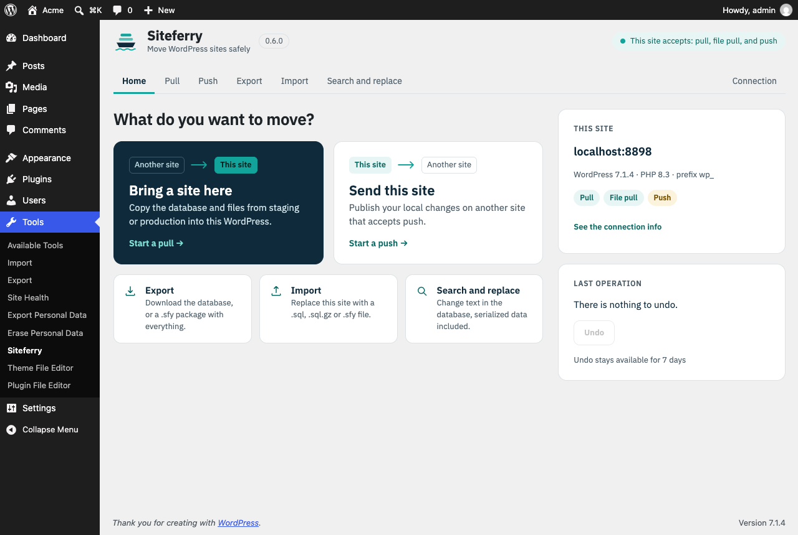
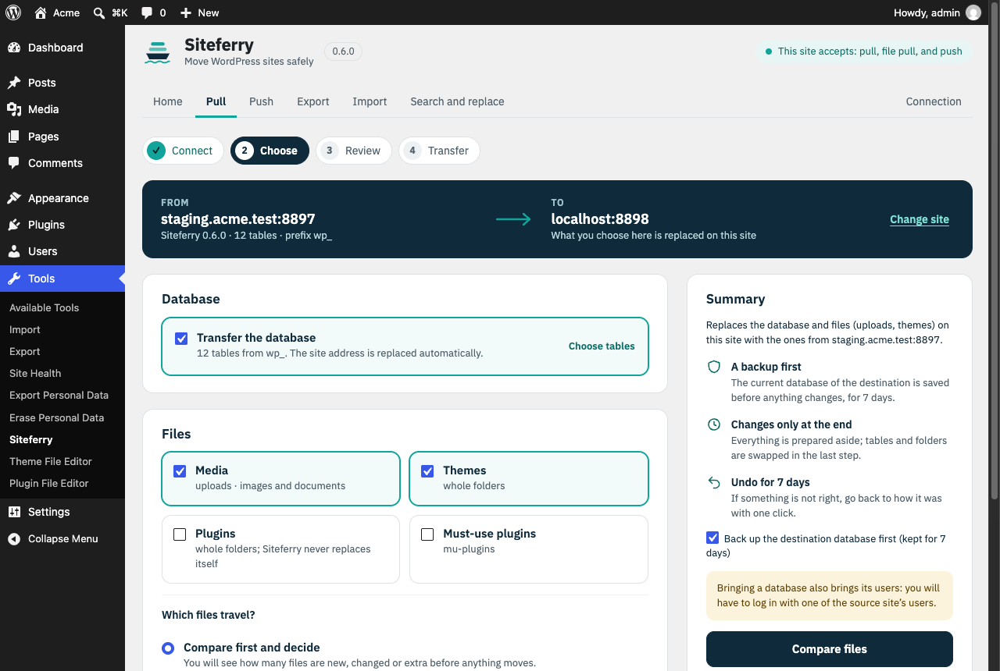
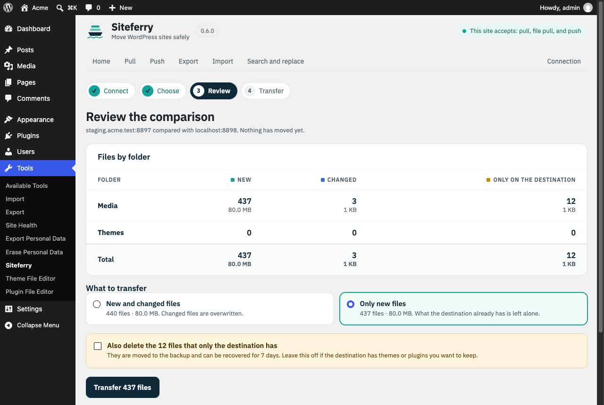

<h1 align="center">
  <picture>
    <source media="(prefers-color-scheme: dark)" srcset=".github/brand/logo-dark.png">
    
  </picture>
</h1>

[](https://github.com/kurodaSensei/siteferry/actions/workflows/ci.yml)

[English](README.md)

Siteferry es un plugin de migración para WordPress. Exporta e importa la base de datos y le hace buscar/reemplazar sin romper datos serializados ni JSON. También trae y envía (pull/push) bases de datos y archivos entre dos sitios por una conexión firmada, empaqueta un sitio entero en un solo archivo `.sfy` y puede deshacer la última operación.

Se usa desde **Herramientas → Siteferry** en el admin y desde WP-CLI (`wp siteferry`). Está escrito en PHP 8.1 puro, sin dependencias en tiempo de ejecución.



<details>
<summary>Más capturas</summary>





</details>

## Funciones

- **Buscar/reemplazar seguro con datos serializados.** El PHP serializado se recorre como texto y se recalcula el largo de cada cadena. Nunca se deserializa, así que no se instancia ningún objeto, y las clases desconocidas, los floats y las referencias quedan tal cual. También se reemplaza dentro de valores JSON, incluidas las barras escapadas. Las expresiones regulares (PCRE) y la distinción de mayúsculas son opcionales.
- **Exportar** la base de datos a `.sql.gz`, con o sin reemplazos para el destino.
- **Importar** un dump de mysqldump, phpMyAdmin o Siteferry. El prefijo de tablas y la URL de origen se detectan solos. Si el dump trae varias instalaciones de WordPress, Siteferry pregunta qué prefijo usar en vez de adivinar. Las vistas, triggers y procedimientos se omiten y se avisa en el registro.
- **Pull y push** de la base de datos entre dos sitios. También pueden viajar archivos: media, temas, plugins y mu-plugins. Solo se envían los archivos que cambiaron, y temas y plugins se cambian por carpeta completa al final.
- **Paquetes de sitio completo.** Un archivo `.sfy` reúne la base de datos y las carpetas elegidas. Se importa desde el admin o con `wp siteferry import`.
- **Deshacer.** Se puede revertir la última operación que modificó el sitio: un buscar/reemplazar, una importación, un pull o un push recibido. Vuelve el backup de la base de datos tomado antes de la operación y regresan los archivos reemplazados. Los archivos nuevos se apartan a `undone/` en vez de borrarse. Los backups se guardan 7 días.
- **Operaciones reanudables.** El trabajo avanza en pasos cortos, uno por petición, y el cursor se guarda en el servidor. Un timeout, una recarga o una conexión caída no pierden el progreso: se continúa donde se quedó.

## Requisitos

- WordPress 6.0 o superior. Multisite todavía no está soportado.
- PHP 8.1 o superior, con la extensión `mysqli` que ya usa WordPress.
- MySQL 8.0 o MariaDB 10.6, que son las versiones con las que corren las pruebas. Versiones anteriores pueden funcionar, pero no están probadas.

## Instalación

1. Arma el zip instalable desde el repositorio: `bin/build.sh` genera `dist/siteferry-<versión>.zip`. Contiene el último commit, sin tests ni herramientas de desarrollo.
2. En WordPress, ve a **Plugins → Añadir nuevo → Subir plugin**, sube el zip y actívalo.
3. En nginx, bloquea el acceso directo a la carpeta de trabajo (en Apache ya se crea un `.htaccess`):

   ```nginx
   location ~* /uploads/siteferry- { deny all; }
   ```

Al desactivar Siteferry se quitan su mu-plugin y la limpieza diaria. Al borrarlo desde **Plugins** se eliminan además sus opciones, las tablas temporales que queden y su carpeta de trabajo, con los dumps, los backups y los puntos de deshacer.

## Uso

### En el admin

**Herramientas → Siteferry** ofrece Exportar, Buscar y reemplazar, Importar, Pull y Push. Añades los pares buscar/reemplazar, eliges las tablas y pulsas **Iniciar**. El progreso, el registro y los enlaces de descarga aparecen en la misma página. La tarjeta **Deshacer** muestra qué restauraría la última operación.

### WP-CLI

```bash
# Exportar con un reemplazo, o un paquete de sitio completo
wp siteferry export https://example.com https://example.test --output=site.sql.gz
wp siteferry export --media --themes --plugins --output=site.sfy

# Buscar/reemplazar en este sitio (antes se hace un backup)
wp siteferry replace https://old.example https://new.example

# Importar un dump o un paquete (la URL de origen se reemplaza sola)
wp siteferry import site.sql.gz

# Deshacer la última operación que modificó este sitio
wp siteferry undo
```

`wp help siteferry <comando>` muestra todas las opciones: `--tables`, `--regex`, `--case-sensitive`, `--guids`, `--no-backup`, `--no-auto-url`, `--source-prefix` y las demás.

### Conectar dos sitios

1. En el sitio que se va a leer o escribir, activa solo los permisos que necesites. Todos vienen desactivados.

   ```bash
   wp siteferry connection --allow-pull=on --allow-pull-files=on
   ```

   El comando muestra la **información de conexión** del sitio: su URL y una clave de 40 caracteres. Trata la clave como una contraseña. `--regenerate-key` la invalida.

2. En el otro sitio, haz pull o push con esa URL y esa clave:

   ```bash
   wp siteferry pull https://production.example <clave> --media
   wp siteferry push https://staging.example <clave> --themes --plugins --files-only
   ```

Hay cuatro permisos separados:

| Permiso | Qué puede hacer el otro sitio |
|---|---|
| **pull** | leer la base de datos |
| **pull de archivos** | leer media, temas y plugins |
| **push** | reemplazar la base de datos |
| **push de código** | reemplazar temas y plugins |

`--delete` borra en el destino los archivos que ya no existen en el origen. Los borrados van a un backup de 7 días.

## Cómo protege el sitio

**Las tablas vivas solo se tocan una vez, al final.** Lo importado o transferido entra primero en tablas temporales: `_sfr_` para los dumps crudos y `_sft_` para las tablas nuevas. Los reemplazos se hacen ahí. Al final, un solo `RENAME TABLE` las pone en su lugar. Si algo falla antes, el sitio queda igual, y **Cancelar** borra lo temporal. Por defecto se hace antes un backup del destino.

**El estado del plugin sobrevive al cambio de base de datos.** Las opciones propias `siteferry_*` nunca se exportan y se conservan en el destino cuando se reemplaza su base de datos. También se conserva `blog_public`, para que un staging siga oculto a los buscadores. Con el filtro `siteferry_preserved_options` se pueden conservar más opciones.

**La comunicación entre sitios va firmada y no se puede repetir.**
- Cada petición y cada respuesta llevan una firma HMAC-SHA256 sobre el cuerpo completo. El cuerpo incluye una marca de tiempo (se toleran ±5 minutos) y un nonce de un solo uso.
- La respuesta lleva el nonce de su petición, así que no sirve como respuesta a otra.
- Los paquetes binarios de archivos van cubiertos por su SHA-256 firmado.

**Se rechaza http fuera de desarrollo.** Solo se acepta http con hosts de desarrollo: `localhost`, `.test`, `.local`, `.localhost`, `.internal` e IPs privadas. En cualquier otro caso la base de datos cruzaría la red sin cifrar, así que se exige https.

**Un sitio remoto no puede ejecutar SQL arbitrario.** Las sentencias que envía solo pueden crear, llenar o borrar una tabla temporal `_sft_`. Se revisan sus literales y comentarios antes de ejecutar nada.

**Los archivos que llegan se revisan antes de escribirlos.**
- Las rutas se normalizan y no pueden salir de su raíz.
- En media se rechazan ejecutables y archivos de configuración del servidor (`.php`, `.phtml`, `.htaccess`, `.user.ini`, …).
- Siteferry nunca se sobrescribe a sí mismo.
- Se excluyen cachés, carpetas de control de versiones y las carpetas de backup de otros plugins.

**Se evitan interferencias de otros plugins.** Durante los pasos de una migración, un pequeño mu-plugin desactiva los demás plugins y el tema. Solo actúa en las rutas REST de Siteferry y solo con una clave o una firma válida. Siteferry lo instala y lo quita al desactivarse.

**La carpeta de trabajo está protegida.** Los dumps y backups viven en `wp-content/uploads/siteferry-<aleatorio>/`, protegida con `index.php` y `.htaccess`. Los archivos solo se descargan por peticiones REST autenticadas. Una limpieza diaria borra lo que tenga más de 7 días.

## Hooks

| Hook | Tipo | Argumentos |
|---|---|---|
| `siteferry_job_started` | acción | `array $job` |
| `siteferry_job_completed` | acción | `array $job` |
| `siteferry_job_failed` | acción | `array $job` |
| `siteferry_preserved_options` | filtro | `string[] $options` (por defecto: `blog_public`) |

## Limitaciones

- Las redes multisite todavía no están soportadas.
- Un `.sql.gz` subido se descomprime en una sola petición. Para dumps de varios GB en hostings con límites de tiempo cortos, sube el `.sql` sin comprimir.
- El registro de progreso, los nombres de los pasos y la salida de WP-CLI están en inglés. La interfaz del admin es traducible y viene en español (`es_ES`).

## Desarrollo

Necesitas PHP 8.1+ con `mysqli`, y Composer. Si no los tienes instalados, sirve Docker con las imágenes oficiales.

```bash
composer install
composer lint   # PHPCS con los WordPress Coding Standards
composer test   # PHPUnit (solo unitarias si no hay base de datos de prueba)
```

Las pruebas de integración crean y borran bases de datos desechables. Apúntalas a un MySQL o MariaDB de usar y tirar con `SITEFERRY_TEST_DB_HOST`. `SITEFERRY_TEST_DB_USER` y `SITEFERRY_TEST_DB_PASS` son opcionales; por defecto valen `root`/`root`.

```bash
docker network create siteferry-dev
docker run -d --rm --name siteferry-db --network siteferry-dev -e MYSQL_ROOT_PASSWORD=root mysql:8.0
docker run --rm -v "$PWD":/app -w /app composer:2 composer install
docker run --rm --network siteferry-dev -e SITEFERRY_TEST_DB_HOST=siteferry-db -v "$PWD":/app -w /app \
  php:8.3-cli sh -c 'docker-php-ext-install mysqli >/dev/null && vendor/bin/phpunit'
```

Dale unos 20 segundos al servidor de base de datos para arrancar antes de correr las pruebas. Antes de enviar un cambio, repite el último comando contra `mariadb:10.6` (`-e MARIADB_ROOT_PASSWORD=root`).

El fixture `tests/fixtures/mysqldump-wp.sql` es un dump real de mysqldump 8.0 generado a partir de `tests/fixtures/seed-wp.sql`, que incluye una vista, un trigger y una llave foránea.

Las traducciones están en `languages/`. Para regenerarlas, corre WP-CLI desde la carpeta del plugin:

```bash
wp i18n make-pot . languages/siteferry.pot --domain=siteferry --exclude=vendor,tests,dist,bin,languages
wp i18n make-mo languages/siteferry-es_ES.po languages
wp i18n make-json languages/siteferry-es_ES.po languages --no-purge
```

### Estructura

```text
siteferry.php        Cabecera del plugin y autoloader
uninstall.php        Borra opciones, tablas temporales y la carpeta de trabajo al eliminar el plugin
src/Engine/          Buscar/reemplazar, lectura y escritura de SQL, copia y cambio de tablas (sin depender de WordPress)
src/Files/           Escaneo de archivos, diferencias, paquetes y protección de rutas
src/Job/             Planificador, ejecutor de pasos y almacenamiento de operaciones
src/Remote/          Protocolo cliente/servidor firmado entre sitios
src/Http/            Rutas REST para la interfaz del admin y para otros sitios
src/Admin/, assets/  Página Herramientas → Siteferry y su script
src/Cli/             Comando de WP-CLI
mu-plugin/           mu-plugin de compatibilidad para los pasos de migración
tests/               Pruebas unitarias y de integración con PHPUnit
```

## Licencia

[GPL-2.0-or-later](LICENSE). Siteferry es un proyecto independiente, escrito desde cero, y no está afiliado a ningún otro plugin de migración.
