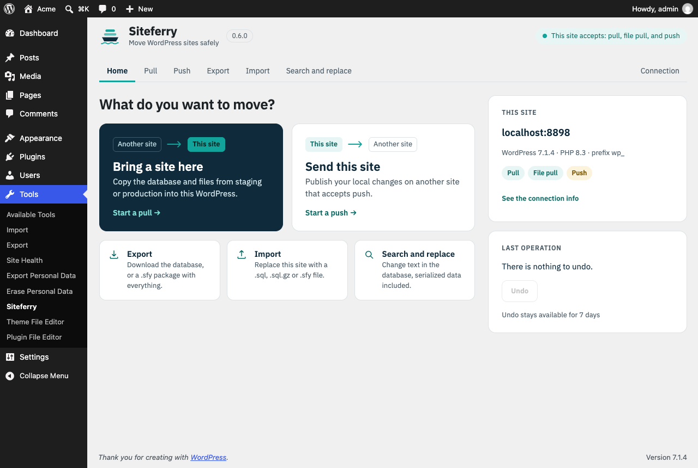
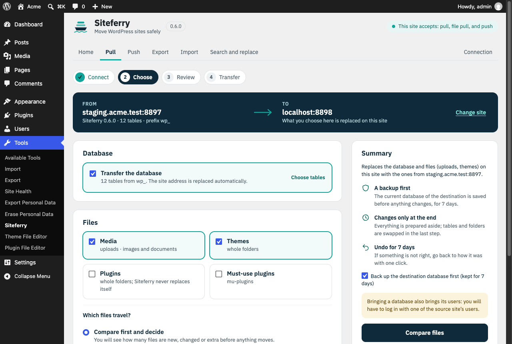
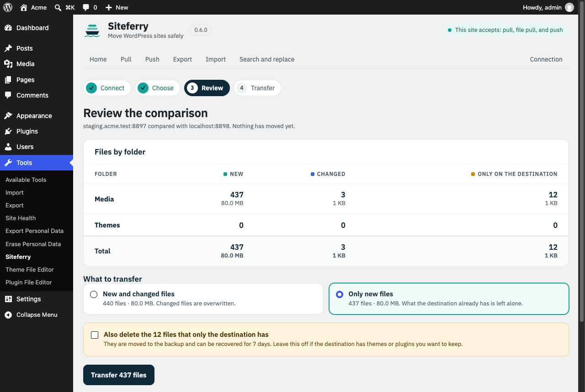
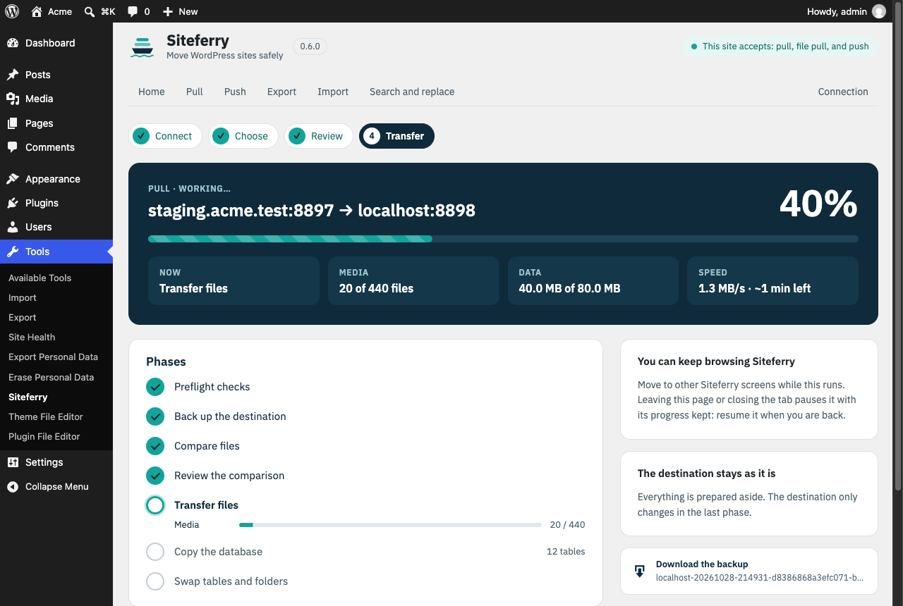
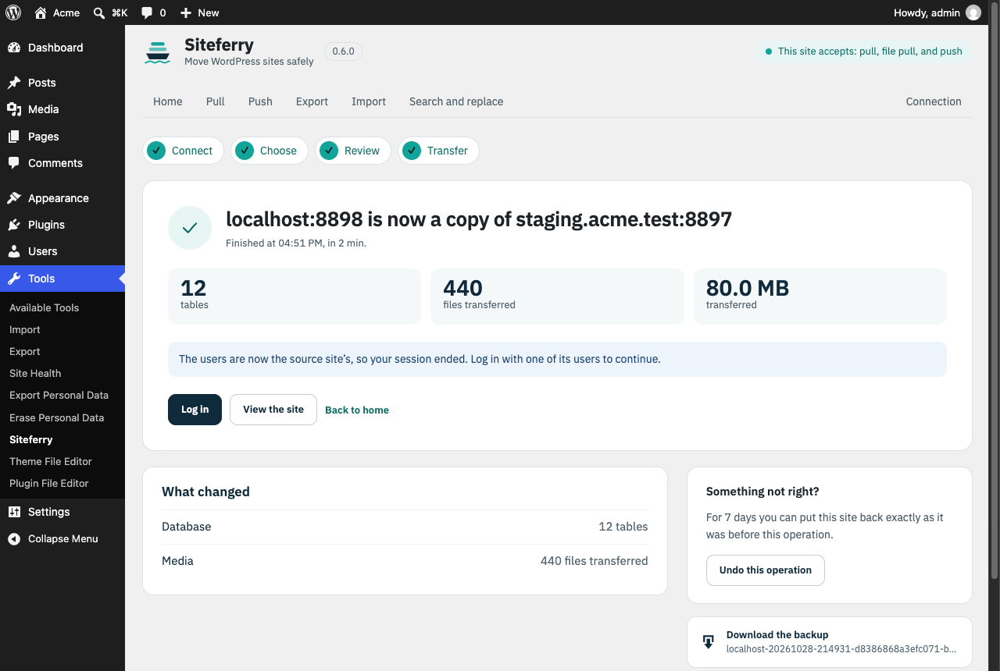
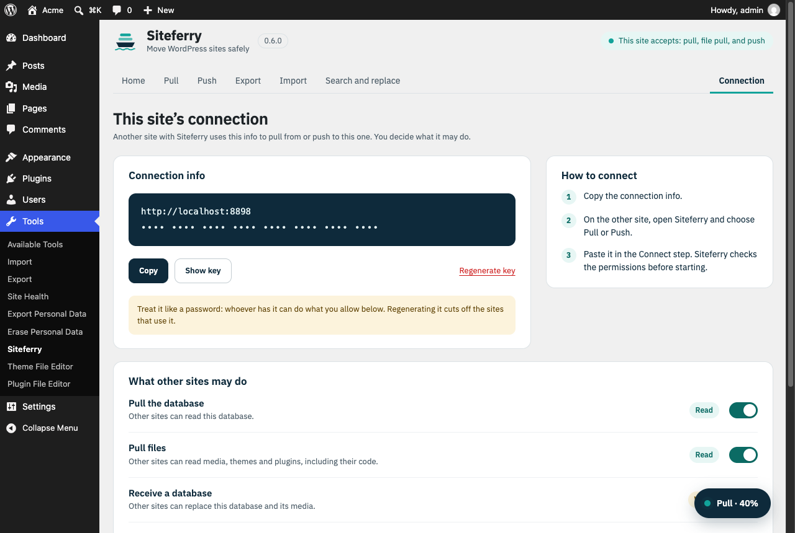

<h1 align="center">
  <picture>
    <source media="(prefers-color-scheme: dark)" srcset=".github/brand/logo-dark.png">
    
  </picture>
</h1>

[](https://github.com/kurodaSensei/siteferry/actions/workflows/ci.yml)

[Español](README.es.md)

Siteferry is a WordPress migration plugin. It exports, imports and runs search-replace on the database without breaking serialized data or JSON. It also pulls and pushes databases and files between two sites over a signed connection, packs a whole site into one `.sfy` file, and can undo the last operation.

It works from **Tools → Siteferry** in the admin and from WP-CLI (`wp siteferry`). It is pure PHP 8.1 and has no runtime dependencies.



<details>
<summary>More screenshots</summary>











</details>

## Features

- **Serialized-safe search-replace.** Serialized PHP is processed as text and every string length is recalculated. Nothing is ever unserialized, so no objects are instantiated, and unknown classes, floats and references come out exactly as they went in. JSON values, including escaped slashes, are replaced as well. Regular expressions (PCRE) and case-sensitive matching are optional.
- **Export** the database to `.sql.gz`, with or without replacements for the destination.
- **Import** a dump from mysqldump, phpMyAdmin or Siteferry. The table prefix and the source URL are detected automatically. If a dump holds several WordPress installs, Siteferry asks which prefix to use instead of guessing. Views, triggers and procedures are skipped and reported in the log.
- **Pull and push** the database between two sites. Files can travel too: media, themes, plugins and mu-plugins. Only files that changed are sent, and themes and plugins are swapped as whole folders at the end.
- **Review before transferring.** A pull or push can stop after comparing the files and show how many are new, changed or only on the destination, with their size. You then bring new and changed files, or only new ones, and choose whether to delete what only the destination has.
- **Full-site packages.** One `.sfy` file holds the database and the selected folders. You import it from the admin or with `wp siteferry import`.
- **Undo.** The last operation that changed the site can be reverted: a search-replace, an import, a pull, or a push this site received. The pre-operation database backup is restored, and files that were replaced come back. New files are moved aside to `undone/` instead of being deleted. Backups are kept for 7 days.
- **Resumable jobs.** Work runs in short steps, one per request, with the cursor stored on the server. A timeout, a reload or a dropped connection does not lose progress: you resume where it stopped. When the other site stops answering, a pull or push pauses instead of failing, and a clock difference between the two sites is corrected automatically.

## Requirements

- WordPress 6.0 or later. Multisite is not supported yet.
- PHP 8.1 or later, with the `mysqli` extension that WordPress uses.
- MySQL 8.0 or MariaDB 10.6, the versions the test suite runs on. Older versions may work but are untested.

## Installation

1. Build the installable zip from a checkout: `bin/build.sh` writes `dist/siteferry-<version>.zip`. It contains the last commit, without tests or dev tooling.
2. In WordPress, go to **Plugins → Add New → Upload Plugin** and upload the zip, then activate it.
3. On nginx, deny direct access to the working folder (Apache already gets an `.htaccess`):

   ```nginx
   location ~* /uploads/siteferry- { deny all; }
   ```

Deactivating Siteferry removes its mu-plugin and the daily cleanup. Deleting it from **Plugins** also removes its options, any temporary tables and its working folder, including dumps, backups and undo points.

## Usage

### In the admin

**Tools → Siteferry** opens on a home screen: pull or push, export, import and search-replace, plus this site's address and permissions and the last operation, which you can undo from there.

- **Pull and push** are a four-step wizard. *Connect* takes the other site's connection info. *Choose* shows the route between the two sites and lets you pick the database, the folders, and whether to compare the files first. *Review* is the comparison, if you asked for it. *Transfer* runs it.
- **Export, import and search-replace** are a single form each. Replacements, advanced options and the table list are folded under **Replacements and advanced options**.
- **The progress screen** shows the phases, a bar per folder while files travel, and the transfer speed with an estimate of the time left. You can move to other Siteferry screens meanwhile: a floating button leads back to the operation. Leaving the page pauses it, and it can be resumed later.
- **The result screen** says what changed, offers to undo it for 7 days, and links the backup or the export for download.
- **Connection** shows this site's connection info with the key masked, and a switch for each permission other sites get.

Confirmations and messages appear in the page's own dialog.

### WP-CLI

```bash
# Export with a replacement, or a full-site package
wp siteferry export https://example.com https://example.test --output=site.sql.gz
wp siteferry export --media --themes --plugins --output=site.sfy

# Search-replace on this site (a backup is taken first)
wp siteferry replace https://old.example https://new.example

# Import a dump or a package (the source URL is replaced automatically)
wp siteferry import site.sql.gz

# Undo the last operation that changed this site
wp siteferry undo
```

Run `wp help siteferry <command>` for every option: `--tables`, `--regex`, `--case-sensitive`, `--guids`, `--no-backup`, `--no-auto-url`, `--source-prefix` and the rest.

### Connecting two sites

1. On the site that will be read from or written to, enable only the permissions you need. All of them are off by default.

   ```bash
   wp siteferry connection --allow-pull=on --allow-pull-files=on
   ```

   This prints the site's **connection info**: its URL and a 40-character key. Treat the key like a password. `--regenerate-key` invalidates it.

2. On the other site, pull or push with that URL and key:

   ```bash
   wp siteferry pull https://production.example <key> --media --only-new
   wp siteferry push https://staging.example <key> --themes --plugins --files-only
   ```

   In the admin, the same info is on **Connection**, and you paste it in the *Connect* step of a pull or push.

There are four separate permissions:

| Permission | What the other site can do |
|---|---|
| **pull** | read the database |
| **file pull** | read media, themes and plugins |
| **push** | replace the database |
| **code push** | replace themes and plugins |

`--delete` removes files on the destination that no longer exist on the source. Deleted files are moved to a 7-day backup instead. `--only-new` sends only files the destination does not have. If the other site stops answering, WP-CLI retries the paused job 5 times, every 30 seconds.

## How it keeps a site safe

**Live tables are only touched once, at the end.** Imported and transferred data first lands in temporary tables: `_sfr_` for raw dumps and `_sft_` for new tables. Replacements run there. At the end, a single `RENAME TABLE` swaps them in. If anything fails before that, the site is unchanged, and **Cancel** removes the temporary data. A backup of the destination is taken first by default.

**Plugin state survives a database swap.** Siteferry's own `siteferry_*` options are never exported and are kept on the destination when its database is replaced. `blog_public` is kept as well, so a staging site stays hidden from search engines. The `siteferry_preserved_options` filter adds more options to keep.

**Communication between sites is signed and replay-proof.**
- Every request and response is signed with HMAC-SHA256 over the whole body. The body includes a timestamp (±5 minutes are tolerated) and a single-use nonce.
- If the two clocks differ by more than that, the receiving site says so in a signed response with its own time, and the request is signed once more with that offset. The receiver still checks the time against its own clock.
- A response carries its request's nonce, so it cannot be replayed as the answer to another request.
- Binary file packages are covered by their signed SHA-256.

**http is refused outside development.** Plain http is accepted only for development hosts: `localhost`, `.test`, `.local`, `.localhost`, `.internal`, and private IPs. Everywhere else the database would cross the network unencrypted, so https is required.

**A remote site cannot run arbitrary SQL.** Statements it sends may only create, fill or drop one temporary `_sft_` table. Literals and comments are checked before anything runs.

**Incoming files are checked before they are written.**
- Paths are normalized and confined to their root.
- Executables and server config files (`.php`, `.phtml`, `.htaccess`, `.user.ini`, …) are rejected inside media.
- Siteferry never overwrites itself.
- Caches, VCS folders and other plugins' backup folders are excluded.

**Interference from other plugins is avoided.** During migration steps, a small mu-plugin switches off the other plugins and the theme. It only acts on Siteferry's own REST routes, and only with a valid key or signature. Siteferry installs it and removes it again when deactivated.

**The working folder is protected.** Dumps and backups live in `wp-content/uploads/siteferry-<random>/` with `index.php` and `.htaccess` guards. Files are only downloaded through authenticated REST requests. Anything older than 7 days is removed by a daily cleanup.

## Hooks

| Hook | Type | Arguments |
|---|---|---|
| `siteferry_job_started` | action | `array $job` |
| `siteferry_job_completed` | action | `array $job` |
| `siteferry_job_failed` | action | `array $job` |
| `siteferry_preserved_options` | filter | `string[] $options` (default: `blog_public`) |

## Limitations

- Multisite networks are not supported yet.
- A `.sql.gz` upload is decompressed in a single request. For dumps of several GB on hosts with short request limits, upload the uncompressed `.sql`.
- In the admin, the operation advances while the Siteferry page is open. Leaving it pauses the operation until you come back and resume. WP-CLI runs on its own.
- Progress logs, step names and WP-CLI output are in English. The admin interface is translatable, and it ships with Spanish (`es_ES`).

## Development

You need PHP 8.1+ with `mysqli`, and Composer. Without them installed locally, Docker works with the official images.

```bash
composer install
composer lint   # PHPCS with WordPress Coding Standards
composer test   # PHPUnit (unit tests only, unless a test database is configured)
```

The integration tests create and drop throwaway databases. Point them at a disposable MySQL or MariaDB server through `SITEFERRY_TEST_DB_HOST`. `SITEFERRY_TEST_DB_USER` and `SITEFERRY_TEST_DB_PASS` are optional and default to `root`/`root`.

```bash
docker network create siteferry-dev
docker run -d --rm --name siteferry-db --network siteferry-dev -e MYSQL_ROOT_PASSWORD=root mysql:8.0
docker run --rm -v "$PWD":/app -w /app composer:2 composer install
docker run --rm --network siteferry-dev -e SITEFERRY_TEST_DB_HOST=siteferry-db -v "$PWD":/app -w /app \
  php:8.3-cli sh -c 'docker-php-ext-install mysqli >/dev/null && vendor/bin/phpunit'
```

Give the database server about 20 seconds to start before running the tests. Repeat the last command against `mariadb:10.6` (`-e MARIADB_ROOT_PASSWORD=root`) before you send a change.

The `tests/fixtures/mysqldump-wp.sql` fixture is a real mysqldump 8.0 dump of `tests/fixtures/seed-wp.sql`, which contains a view, a trigger and a foreign key.

Translations live in `languages/`. To refresh them, run WP-CLI from the plugin folder:

```bash
wp i18n make-pot . languages/siteferry.pot --domain=siteferry --exclude=vendor,tests,dist,bin,languages
wp i18n make-mo languages/siteferry-es_ES.po languages
wp i18n make-json languages/siteferry-es_ES.po languages --no-purge
```

### Project layout

```text
siteferry.php        Plugin header and autoloader
uninstall.php        Removes options, temporary tables and the working folder when the plugin is deleted
src/Engine/          Search-replace, SQL reading/writing, table copy and swap (no WordPress dependency)
src/Files/           File scanning, diffs, packages and path guards
src/Job/             Job planner, step runner and storage
src/Remote/          Signed client/server protocol between sites
src/Http/            REST routes for the admin UI and for other sites
src/Admin/, assets/  Tools → Siteferry page, its script and styles, and the bundled IBM Plex Sans
src/Cli/             WP-CLI command
mu-plugin/           Compatibility mu-plugin used during migration steps
tests/               PHPUnit unit and integration tests
```

## License

[GPL-2.0-or-later](LICENSE). The bundled IBM Plex Sans font is under the [SIL Open Font License 1.1](assets/fonts/OFL.txt). Siteferry is an independent project, written from scratch, and is not affiliated with any other migration plugin.
